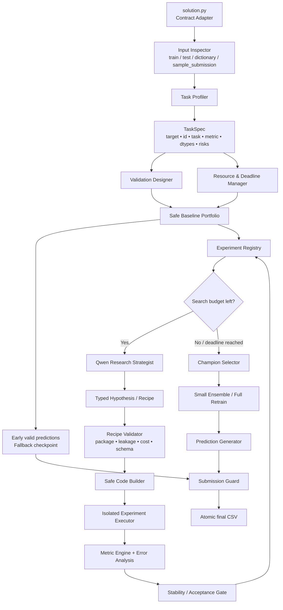

# Анализ ТЗ хакатона Альфа-Банка «AI-агент для разработки ML-моделей»: конкуренты, архитектура и план реализации

## Executive summary

**Статус ТЗ.** В исходной формулировке запроса было указано отметить «**ТЗ не предоставлено**». Фактически к диалогу приложен PDF **«Альфа Хак_AutoML» на 20 страниц**, поэтому это условие уже неактуально: ниже анализируется реальное ТЗ. При этом не приложены критически важные сопутствующие артефакты, на которые ссылается сам документ: `baseline.py`, `requirements.txt`, архивы данных и детальное описание API доступной LLM. fileciteturn0file0

Задача хакатона — не обычный AutoML. Требуется автономный агент, который получает новую ML-задачу, разбирает ее условие и данные, определяет тип задачи и метрику, строит собственную валидацию, выбирает подход, генерирует и запускает код, проводит AutoResearch-цикл «гипотеза → эксперимент → оценка → следующая гипотеза» и в конце создает файл предсказаний. Публично известны регрессия с RMSE и многоклассовая классификация с Macro F1; финальная проверка проводится еще на двух неизвестных задачах тем же неизменным кодом. На каждую задачу дается максимум три часа, 8 CPU и 32 ГБ RAM; используется Python 3.12, интернет закрыт, предобученные модели запрещены, а сторонние LLM/API-ключи использовать нельзя. fileciteturn0file0

**Главный архитектурный вывод:** команде не следует строить «свободного LLM-агента», который каждый раз с нуля пишет большой Python-скрипт. Для трехчасового CPU-only режима это слишком ненадежно. Оптимальная схема — **гибридный исследовательский агент**:

> **LLM решает, что исследовать; детерминированное ядро решает, как безопасно и воспроизводимо это выполнить и измерить.**

Иными словами, Qwen должен выступать не в роли единственного ML-инженера, а в роли **стратега AutoResearch**. Он получает компактный профиль данных, историю экспериментов и анализ ошибок, формирует структурированную гипотезу; затем доверенный `Recipe/Code Builder` превращает ее в ограниченный Python-код, валидатор проверяет допустимость, executor запускает эксперимент, а строгий evaluator независимо рассчитывает метрику. Такая конструкция сохраняет требуемую «агентность» и генерацию кода, но резко снижает вероятность галлюцинаций, утечек данных, синтаксических ошибок и потери всего запуска.

Это особенно важно потому, что известные ML-агенты обычно исследуются при намного более щедрых ресурсах. Например, рекомендуемая конфигурация OpenAI MLE-bench — 24 часа, 36 vCPU, 440 ГБ RAM и GPU A10, тогда как здесь — три часа, 8 CPU, 32 ГБ и без GPU. Сам MLE-bench отдельно предупреждает о высокой вариативности результатов агентов и рекомендует многократные запуски. Поэтому буквально переносить AIDE или RD-Agent в контейнер Альфа-Банка нерационально. citeturn16search0turn16search1

Наиболее близкий российский аналог — **LightAutoDS-Tab (LADS)** от Sber AI Lab: мульти-AutoML агент для табличных задач, который совмещает LLM-генерацию кода и несколько AutoML-инструментов. Международные прямые аналоги — Microsoft RD-Agent и AIDE/Weco; концептуальный эталон исследовательского цикла — Karpathy `autoresearch`. Среди классических AutoML особенно полезны идеи FLAML и AutoGluon: явный временной бюджет, быстрое построение сильного baseline, портфель моделей и ансамбли. citeturn15search1turn16search1turn17search3turn16search8turn18search0turn19search4

**Рекомендуемый продукт — `AlphaResearch Agent`:** resource-aware автономный ML-researcher, отличающийся от конкурентов четырьмя вещами: строгим трехчасовым scheduler'ом, typed hypothesis DSL вместо произвольного кода, защищенной валидацией и гарантированным fallback-submission. Главное правило исполнения: **валидный результат должен существовать уже через 15–25 минут; оставшееся время агент только улучшает его.**

Для студенческой команды из четырех человек разумная стратегия — сначала за 1–2 дня построить полностью детерминированный универсальный baseline, затем добавить Agent/AutoResearch поверх уже работающей системы. Это гораздо сильнее стратегии «сначала сделать красивую мультиагентную архитектуру, потом пытаться заставить ее обучать модели».

---

## Разбор ТЗ и явные предположения

ТЗ сформулировано достаточно хорошо в части runtime-ограничений и цели, но недостаточно полно для окончательной реализации. Особенно важно, что критерий победы фактически состоит не в максимизации публичных двух датасетов, а в **обобщении на две неизвестные private-задачи**. На private-проверке берется выбранная версия решения и повторно запускается через тот же `solution.py`, причем код уже нельзя адаптировать под новые данные вручную. Следовательно, любые жестко зашитые эвристики вида `if target == "site_eui"` прямо противоречат стратегической сути соревнования. fileciteturn0file0

В ТЗ на страницах 5–8 сформулированы ключевые функции: понимание текстового условия, анализ структуры данных, определение типа ML-задачи, автоматический выбор подхода, генерация и выполнение кода, обучение, собственная валидация, формирование предсказаний и AutoResearch-цикл. Разрешена как одноагентная, так и мультиагентная схема, а гипотезы могут касаться алгоритмов, гиперпараметров, обработки и очистки данных, feature engineering, feature selection и схемы валидации. fileciteturn0file0

### Что известно и что еще нужно получить

| Категория | Что уже задает PDF | Что критично получить дополнительно |
|---|---|---|
| **Цель** | Автономное end-to-end решение неизвестной ML-задачи от чтения условия до файла предсказаний; самостоятельное исследование через AutoResearch. | Желательно уточнить, оценивается ли организаторами «агентность» отдельно от leaderboard-score или только конечная метрика. |
| **Целевая аудитория** | Из бизнес-контекста следует сценарий внутреннего инструмента для ML-инженера/DS; непосредственный пользователь hackathon-решения — автоматическая проверяющая платформа. | Формально persona, UX и требования к объяснимости продукта не определены. |
| **Функциональные требования** | Task understanding, profiling, task/metric detection, preprocessing, feature engineering, model selection, training, validation, experimentation, predictions. | Точный контракт `baseline.py`: параметры `solution.py`, пути, env vars, API агента, имя/путь выходного файла, допустимые subprocess'ы. |
| **Нефункциональные требования** | Универсальность, автономность, укладывание в 3 часа и 8 CPU/32 ГБ, неизменный код на private. | Disk quota, лимит числа процессов, политика `/tmp`, доступный размер файлов, правила аварийного завершения, ограничения stdout/stderr. |
| **Ограничения** | Python 3.12; без интернета; только данные кейса; без pretrained-моделей; сторонние LLM/API запрещены; доступ к указанной организаторами Qwen; библиотеки ограничены `requirements.txt`. | Сам `requirements.txt` и точные версии библиотек. Без него нельзя утверждать, что доступны CatBoost, LightGBM, XGBoost, AutoGluon, FLAML и т. п. |
| **Критерии оценки** | Public: RMSE и Macro F1, нормированные относительно baseline, одинаковый вес. Private: две неизвестные задачи, среднее их баллов. | Значения baseline `B_RMSE` и `B_F1`; полный список возможных private-метрик либо гарантия, что их формула/название будет передано агенту. |
| **Сроки** | Один запуск — не более 3 часов; максимум 3 сабмита команды в сутки, обновление в 00:00 МСК. | Дата дедлайна, длительность отбора, длительность финальной стадии, время до заморозки лучшей public-версии. |
| **API и данные** | На задачу передаются `train.csv`, `test.csv`, `data_dictionary.csv`, `sample_submission.csv`; агент получает текстовое описание. | Фактические CSV для локальных тестов; Qwen endpoint, протокол, timeout, RPM/TPM, maximum context, модель ответа, retry-policy, возможность structured output. |
| **Безопасность** | Интернет недоступен, собственные API-ключи запрещены, обучение только на выданных данных. | Требования к secrets handling, логированию промптов, хранению промежуточных файлов и допустимости `exec/subprocess`. Никакие требования PCI DSS, ПДн, банковского production-compliance в PDF не заданы. |
| **Комплаенс** | Только ограничения hackathon-среды. | Если решение предполагается переносить в промышленный контур банка, понадобится отдельное ТЗ по классификации данных, аудиту действий агента, retention, разграничению доступа и модели угроз. Их нельзя корректно домыслить из текущего кейса. |

fileciteturn0file0

### Публичные задачи и их значение для дизайна

Публичная регрессия содержит 53 308 строк, 62 входных признака, `id` и target `site_eui`; тест — 22 449 строк, метрика — RMSE. Публичная многоклассовая классификация содержит 87 670 строк, 42 признака, `id` и `attack_cat`; тест — 41 166 строк, основная метрика — Macro F1. Обе задачи достаточно малы, чтобы делать несколько CPU-экспериментов, но достаточно велики, чтобы плохо спроектированная многократная CV и массивный ансамбль легко съели трехчасовой бюджет. fileciteturn0file0

Для классификации выбор Macro F1 принципиален: каждый класс влияет одинаково независимо от частоты, поэтому агент должен анализировать дисбаланс, per-class recall/F1 и обязательно использовать стратифицированную валидацию, когда это допустимо структурой данных. Для регрессии с RMSE сильные ошибки штрафуются квадратично, поэтому агенту полезно исследовать target distribution, выбросы, target transformation и устойчивость clipping/postprocessing — но принимать такие изменения следует только по честной validation-метрике.

Формула оценки дополнительно делает опасным «улучшение ради улучшения»: результат на уровне baseline или хуже превращается в ноль баллов, а дальнейший выигрыш нормируется относительно baseline и идеального значения. Следовательно, первая задача агента — не получить максимальный score, а **гарантированно перейти baseline и не упасть технически**. После этого исследовательский бюджет должен расходоваться на устойчивые улучшения. fileciteturn0file0

### Явные предположения этого отчета

| Предположение | Почему оно необходимо | Что делать после получения полного пакета |
|---|---|---|
| Команда состоит примерно из 4 студентов | Размер команды не задан. | Перераспределить роли; архитектуру это практически не меняет. |
| Private-задачи приходят через те же CSV/description/sample-submission интерфейсы | Это следует из приложения ТЗ, но их содержание неизвестно. | Проверить точный `baseline.py`. |
| Private-задача сообщает агенту свою метрику | Иначе корректно выбрать validation objective невозможно. | Проверить contract; при необходимости расширить metric parser. |
| Финальное решение ориентировано прежде всего на табличные данные | Все публичные примеры табличные и интерфейс CSV-ориентированный. | Не зашивать это жестко: `TaskSpec` должен позволять расширение. |
| Можно писать локальные файлы внутри контейнера | Иначе невозможно нормально вести experiment registry. | Проверить disk/write policy. |
| Можно выполнять сгенерированный локальный Python | ТЗ прямо говорит о генерации и запуске кода. | Выяснить допустимые subprocess и sandbox-ограничения. |
| Доступ к Qwen остается во время platform-run | Иначе агентная часть не сможет работать. | Реализовать deterministic fallback, способный решить задачу без LLM. |

**Ключевое следствие:** систему надо проектировать так, чтобы нарушение почти любого из этих предположений приводило не к падению, а к **degraded mode**.

---

## Конкурентный ландшафт

Поиск проводился не только по слову AutoML, поскольку прямыми конкурентами кейса являются три разных класса систем.

**Критерии поиска:** банковские/финтех ML-платформы; российские B2B-сервисы; международные коммерческие AutoML; open-source AutoML; open-source и коммерческие ML-engineering agents; инструменты autonomous research. B2C/no-code-направление также рассматривалось, однако среди наиболее релевантных решений доминируют B2B, B2D и internal developer platforms: конечная ценность здесь — не пользовательское приложение для массового клиента, а ускорение работы ML/DS-команд.

В России прямой ориентир дает Sber AI Lab, а как смежный банковский пример — внутренний **ML Core Т-Банка**: сам Т-Банк описывает его как расширяемую платформу для разработки и внедрения ML-моделей во внутренние бизнес-процессы; вокруг нее присутствуют CI/CD, оркестрация ML-пайплайнов и мониторинг. Это подтверждает сам бизнес-тезис ТЗ Альфа-Банка: крупные финансовые компании действительно инвестируют в автоматизацию ML development lifecycle. ML Core, однако, является скорее MLOps/ML platform, чем автономным AutoResearch-агентом, поэтому ниже он рассматривается как смежный ориентир, а не прямой аналог. citeturn22search0turn22search1

| Решение | Целевая аудитория и краткое описание | Ключевые функции | Бизнес-модель | Плюсы относительно кейса | Минусы относительно кейса |
|---|---|---|---|---|---|
| **LightAutoDS-Tab / LADS, Sber AI Lab** citeturn15search1 | DS/ML-инженеры и менее технические пользователи; российская multi-AutoML agentic system для табличных данных. | LLM-генерация кода, несколько AutoML backend'ов, построение ML pipeline, техническое и упрощенное отображение процесса. | Open-source / R&D-проект. | **Самый прямой архитектурный аналог**; уже реализует полезную идею «LLM + AutoML tools», а не «LLM вместо AutoML». | Полноценная multi-AutoML система тяжелее, чем требуется при 8 CPU/32 ГБ/3 ч; типичная LLM-интеграция предполагает внешние API и не оптимизирована под ограничения Альфа-Банка. |
| **LightAutoML, Sber AI Lab** citeturn15search0turn15search2 | DS/бизнес, особенно табличные финансовые задачи; framework автоматического построения моделей. | Classification, multiclass, regression, готовые tabular presets, feature pipelines, selection, tuning, ансамбли; есть time-utilized подходы. | OSS, Apache 2.0; технология из финансовой экосистемы. | Очень релевантные tabular pipelines; зрелый портфель моделей; российское происхождение и финансовый контекст. | Это **AutoML, а не researcher**: не рассуждает над результатами и не создает семантически новые гипотезы. Доступность в контейнере еще неизвестна. |
| **Cloud.ru ML Space AutoML / Distributed Train** citeturn21search6turn21search5 | Российские B2B/enterprise DS-команды; облачная full-cycle ML-платформа. В документации AutoML-модуль определяется как автоматическое построение моделей на основе LightAutoML; прежний ML Space интегрирован в Evolution/Distributed Train. | Среды обучения, ML pipelines, эксперименты, инфраструктура; AutoML; API и командная работа. | Коммерческий B2B cloud. | Хороший ориентир для «промышленной версии после хакатона»: orchestration, experiment tracking, shared infrastructure. | Нерелевантен как runtime хакатона: облако/интернет запрещены, а задача требует self-contained ZIP. |
| **Microsoft RD-Agent** citeturn16search1 | ML researchers/engineers; агент для автоматизации data/model R&D. | Research и development loops, генерация/изменение решений, эксперименты; опубликованы результаты на MLE-bench. | OSS/R&D-проект Microsoft; косвенно связан с developer/cloud ecosystem. | Ближе всего к формулировке «AI самостоятельно занимается ML R&D»; полезны раздельные Research/Development роли. | Типовые benchmark-конфигурации гораздо богаче ресурсов Альфа-Банка; перенос framework целиком даст большой orchestration overhead. |
| **AIDE ML / Weco** citeturn17search0turn17search3turn17search1 | ML practitioners и исследователи; LLM-driven ML-engineering agent. Weco развивает идею как production-oriented code optimization. | Natural-language goal/metric, генерация и исправление кода, **tree search по пространству решений**, запуск, metric feedback, pruning, experiment visualization. | AIDE — OSS reference implementation; Weco — коммерциализируемый продукт/CLI с credits. | Очень близок к кейсу; tree search лучше линейного «последняя идея → следующая идея», потому что можно вернуться к сильной ветке. | Free-form code search рискован под 3 часа; ветвление дорого по CPU и LLM; внешние модели/API не подходят contest-среде. |
| **Karpathy autoresearch** citeturn16search8 | AI/ML researchers; минималистичный autonomous research harness. | Агент меняет один `train.py`, запускает фиксированный 5-минутный эксперимент, читает metric, сохраняет улучшение или откатывает изменение; единый metric и журнал. | OSS, MIT. | **Идеальная простая модель AutoResearch-loop**: bounded experiment → объективная metric → keep/revert. Фиксированный бюджет делает эксперименты сравнимыми. | Исходный проект специализирован на одном LLM-training setup, GPU и одной метрике, а не на неизвестных табличных задачах. |
| **AutoGluon Tabular** citeturn19search6turn19search4 | DS/ML developers; general-purpose tabular AutoML. | Автоматически определяет prediction problem, делает feature engineering, обучает несколько моделей и ансамбль, поддерживает `time_limit`, bagging/stacking. | OSS developer framework. | Очень сильная идея **portfolio + ensemble + explicit time budget**; минимальный код; надежный baseline. | Может быть ресурсоемким. Новые `extreme`-preset'ы включают tabular foundation models, что в этом хакатоне недопустимо из-за запрета pretrained-моделей; использовать можно лишь конфигурации, прошедшие compliance-check. citeturn19search4turn19search10 |
| **FLAML, Microsoft** citeturn18search0turn18search4 | Разработчики и DS, которым критичен compute/time budget. | Classification, regression, ranking, forecasting; explicit `time_budget`, holdout/CV, sampling, ensemble; cost-aware model/HPO search; best-effort full retrain в рамках бюджета. | OSS framework. | **Особенно подходит философией к кейсу:** качество оптимизируется с учетом wall-clock, а не только metric. | Не умеет сам понять бизнес-смысл признаков или предложить содержательную feature hypothesis; это слой execution, а не agent reasoning. |
| **H2O AutoML** citeturn19search2turn19search11 | Enterprise/DS; классический AutoML. | XGBoost, GBM, GLM, random forests, deep learning, HPO, CV и stacked ensembles; есть runtime limits и leaderboard. | H2O open-source engine плюс коммерческая enterprise-экосистема. | Хороший эталон diversified model portfolio и stacking. | JVM/ensemble overhead и большой набор моделей не оптимальны для крайне ограниченного контейнера; семантического AutoResearch нет. |
| **Azure Machine Learning Automated ML** citeturn20search0turn20search3 | B2B/enterprise DS и no-code пользователи. | Automatic featurization, выбор моделей, classification/regression/forecasting, CV/holdout, max trials, experiment timeout, per-trial timeout и early termination. | Коммерческий Azure cloud. | Полезный референс для budget manager и automatic validation policy. | Требует Azure infrastructure; не может использоваться в закрытом контейнере. Это фиксированный AutoML workflow, а не автономное исследование. |
| **Google Vertex AI End-to-End AutoML** citeturn18search2turn18search9 | Enterprise/cloud ML users. | Data splitting, feature engineering, architecture search, training, ensembling, distillation; classification/regression. | Коммерческий Google Cloud B2B service. | Хороший reference architecture промышленного end-to-end AutoML. | Слишком cloud-centric; требует Vertex/Dataflow/Compute/Storage, что прямо несовместимо с contest runtime. |

### Что важно забрать у конкурентов

Паттерн **LADS** подтверждает, что наиболее перспективен не выбор «агент или AutoML», а **агент поверх портфеля надежных ML-инструментов**. LADS прямо совмещает LLM-based code generation с несколькими AutoML tools. citeturn15search1

Паттерн **AIDE** говорит, что история исследований не должна быть просто линейной. Агенту полезно хранить несколько сильных веток и иногда возвращаться к предыдущему champion вместо продолжения неудачной серии модификаций. Но полный tree search здесь слишком дорог, поэтому разумна упрощенная схема: `champion + 2 candidate branches`. citeturn17search0turn17search3

Паттерн **autoresearch** — каждый эксперимент должен иметь одну гипотезу, жесткий budget, объективную evaluation-функцию и решение keep/reject. Это лучше «пусть LLM пять раз перепишет весь pipeline». citeturn16search8

Паттерн **FLAML/AutoGluon** — время является самостоятельным ресурсом оптимизации. FLAML предоставляет `time_budget`, sampling, выбор CV/holdout и full retrain с учетом оставшегося бюджета; AutoGluon также строит несколько моделей и ансамблей под `time_limit`. citeturn18search4turn19search6

Паттерн **OpenAI MLE-bench** — агентные результаты обладают высокой variance, поэтому один максимальный validation-score не должен автоматически становиться финальной моделью. Лучших кандидатов необходимо перепроверять хотя бы вторым split/seed. Это особенно важно на private-задачах, где нет возможности «доподогнаться» по leaderboard. citeturn16search0

Отсюда позиционирование предлагаемого решения:

> **Не “еще один AutoML”, не “LLM, который пишет Kaggle notebook”, а guarded, budget-aware autonomous researcher для неизвестных табличных ML-задач.**

---

## Идея продукта и архитектура

Предлагаемое рабочее название — **AlphaResearch Agent**.

Его продуктовая идея:

> «Дать ML-инженеру новую размеченную табличную задачу, описание и metric — и через ограниченное время получить воспроизводимое, автоматически исследованное решение вместе с журналом гипотез, validation evidence и готовыми predictions».

Для хакатона конечным артефактом остается CSV, однако архитектуру стоит строить так, чтобы журнал исследований был «первоклассным» внутренним объектом. Это позволит агенту помнить, что уже проверено, почему гипотеза была отклонена и сколько она стоила по времени.

### Главный принцип: агент предлагает, ядро доказывает

LLM не должно самостоятельно решать:

`"validation_score вырос → значит все хорошо"`.

Оно может предложить: «категориальные признаки лучше отдать CatBoost и попробовать class weights», но только deterministic evaluator имеет право определить, стала ли модель лучше.

Предлагается три **логические роли**, но не три постоянно работающих LLM-агента:

| Роль | Реализация | Ответственность |
|---|---|---|
| **Observer** | Детерминированный Python | Читает contract, профилирует данные, обнаруживает target/id/types/missingness/cardinality/group/time candidates, строит `TaskSpec`. |
| **Researcher** | Qwen + structured prompt | На основании `TaskSpec`, лучших экспериментов и error summary предлагает следующую гипотезу. |
| **Judge/Guard** | Детерминированный Python | Валидирует recipe/code, запускает experiment, вычисляет metric, проверяет leakage/stability/runtime и решает promote/reject. |

LLM-critic имеет смысл вызывать редко — например после трех неудачных экспериментов, — вместо отдельного постоянного «Reviewer Agent». Это экономит токены и не создает ложного впечатления, будто голос второй LLM является объективной проверкой.

### Высокоуровневая архитектура



### Что находится внутри `TaskSpec`

Это один из важнейших объектов системы:

```text
TaskSpec
├── target_column
├── id_columns
├── problem_type
├── metric_name
├── metric_direction
├── submission_schema
├── numeric_features
├── categorical_features
├── datetime_candidates
├── text_candidates
├── group_candidates
├── suspected_leakage_columns
├── target_profile
├── class_distribution
├── train_test_drift_summary
├── validation_strategy
└── available_capabilities
```

Target следует обнаруживать не одной эвристикой, а консенсусом: `data_dictionary.role`, разницей колонок `train/test`, структурой `sample_submission` и текстовым условием. Аналогично metric необходимо извлекать из условия и проверять через registry, а не позволять LLM написать произвольную реализацию метрики.

### Почему нужен typed hypothesis DSL

Наивная схема:

```text
LLM → "напиши solution.py" → exec → надежда
```

слишком рискованна.

Лучше:

```json
{
  "hypothesis": "native categorical handling should improve multiclass F1",
  "base_experiment": "exp_007",
  "model_family": "catboost",
  "feature_ops": ["drop_id_like"],
  "target_transform": "none",
  "validation": "current",
  "params": {
    "depth": 7,
    "class_weights": "balanced"
  },
  "max_runtime_sec": 480
}
```

Схема проверяется на:

- наличие библиотеки;
- допустимые параметры;
- отсутствие pretrained-моделей;
- прогнозируемый runtime;
- отсутствие target leakage;
- возможность завершения до deadline.

Затем **Code Builder** генерирует Python из доверенных шаблонов. Таким образом формально выполняется требование ТЗ о генерации и исполнении кода, но LLM не получает неограниченный shell/`eval`.

### Валидация как центральный компонент

Самая большая ошибка команды была бы вложить всю интеллектуальность в выбор моделей и почти ничего — в validation design.

Агент должен определять потенциальную структуру данных:

| Сигнал | Предпочтительная стратегия |
|---|---|
| Ordinary IID classification | Stratified holdout; финалистов проверить дополнительным seed/CV. |
| Ordinary IID regression | Random holdout/KFold; при skew target — проверить стратификацию по target bins. |
| Временная колонка + вероятная временная зависимость | Time-based split, не random. |
| Повторяющиеся entity/group IDs | Group split. |
| Очень редкие классы | Stratified split с контролем наличия каждого класса; возможно CV. |
| Малый датасет | K-fold CV. |
| Большой датасет и жесткий budget | Fast holdout для exploration → CV только для финалистов. |

FLAML прямо поддерживает holdout, CV, group и time split и рассматривает validation method как часть AutoML-конфигурации; Azure AutoML также автоматически переключается между holdout и cross-validation в зависимости от размера данных. Это полезные референсы для собственного Validation Designer. citeturn18search4turn20search0

### Search policy вместо бессистемного перебора

Эксперименты следует разделить на уровни.

**Сначала model diversity.** Несколько разных классов моделей обычно дают больше информации, чем десять вариантов `learning_rate` одной модели.

**Затем data hypotheses.** Missing values, categoricals, datetime decomposition, log transforms, class weights, rare categories, obvious ratio/interaction features.

**Только затем local HPO.** Настройка параметров лучшей семьи.

**В конце ensemble.** Только если validation predictions действительно комплементарны.

Для экономии времени можно использовать упрощенный successive-halving:

`cheap/sample experiment → full holdout → confirmation split → final model`.

Это близко к философии cost-aware AutoML FLAML, а не к brute-force grid search. citeturn18search0turn18search4

### Специальная стратегия для двух public-задач без hardcode

Для известной regression-задачи агент должен сам обнаружить skew target, категориальные/числовые признаки и кандидатов на даты, проверить baseline tree boosting, target transformation при допустимой области `y`, разумное clipping и ансамбль разных tree families.

Для известной Macro-F1-задачи он должен сам обнаружить дисбаланс, сделать stratified validation, сравнить unweighted и weighted training, смотреть per-class confusion/F1 и предпочитать изменения, помогающие слабым классам, а не только accuracy.

Эти стратегии должны срабатывать **из свойств TaskSpec**, а не из имени `site_eui` или `attack_cat`. Тогда та же логика переносится на hidden tasks.

---

## Пайплайн разработки и релиза

Поскольку фактический дедлайн в предоставленном PDF отсутствует, ниже используется относительный план **D−7 … D0**. При наличии всего трех-четырех дней фазы можно выполнять параллельно, но менять их порядок не следует: сначала contract и baseline, затем agentic research.

### Рекомендуемое распределение ролей

Для предположительной команды из четырех студентов:

| Роль | Основная зона |
|---|---|
| **Tech Lead / Agent Engineer** | Controller, prompts, hypothesis DSL, Qwen interaction, интеграция. |
| **ML Engineer** | Task profiling, validation, metrics, models, feature recipes, ensemble. |
| **Platform Engineer** | `solution.py`, Docker mirror, scheduler, execution isolation, packaging, logging. |
| **QA / Research Engineer** | Benchmark suite, adversarial datasets, leakage tests, ablations, submission analysis. |

Критически важно иметь **одного владельца интеграции**. Четыре отдельных «крутых модуля» без регулярно запускаемого end-to-end ZIP почти гарантированно проиграют более простой команде.

### План релиза

| Период | Результат | Функциональность | Definition of Done | Главные метрики |
|---|---|---|---|---|
| **D−7** | Contract skeleton | `solution.py`, input discovery, output writer, timer, capabilities detection | На synthetic regression/classification создается валидный submission без LLM | Crash rate = 0; schema validity = 100% |
| **D−7…D−6** | Deterministic MVP | Task detection, metric registry, profiling, validation, 2–3 safe baselines | Решает разные табличные задачи одним кодом | > baseline на локальном наборе; fallback < 25 мин |
| **D−6…D−5** | Resource-aware core | Budget manager, timeout per experiment, early checkpoint, registry | Искусственное завершение процесса не уничтожает уже готовый результат | Final artifact exists >99% runs |
| **D−5…D−4** | Agent MVP | Qwen prompt, typed hypothesis, schema validator, template code generation | LLM может запустить новую допустимую гипотезу без ручного изменения кода | Valid recipe rate >90% |
| **D−4…D−3** | AutoResearch | Keep/reject, experiment history, error summaries, branching champion/candidates | 5–10 осмысленных автономных экспериментов подряд | Improvement/run; improvement/minute |
| **D−3…D−2** | Robust private generalization | Group/time detection, imbalanced classes, metric variants, dependency fallback | 15–30 разнородных локальных задач проходят без dataset-specific branches | Success rate; worst-quartile quality |
| **D−2…D−1** | Optimization | Candidate promotion, confirmation splits, lightweight ensemble, token budget | Лучшие идеи устойчивы минимум на двух splits/seeds | Stable gain over baseline |
| **D−1** | Release candidate | Offline Docker soak, CPU/RAM limits, final ZIP, deterministic seeds | Несколько полных запусков проходят под аналогичными лимитами | Runtime <175 мин; RAM headroom |
| **D0** | Competition release | Продуманные platform submissions | Не более одной новой версии без локальной ablation evidence | Public/private robustness, не частота submit |

Лимит платформы — всего три сабмита на команду в сутки, поэтому расходовать их на исправление банальных contract-багов недопустимо; эти проблемы должны ловиться локальной проверкой. fileciteturn0file0

### Development pipeline


### Внутренний трехчасовой runtime-план

Сам `solution.py` должен жить по отдельному schedule.

| Время от старта | Что делает агент | Почему |
|---|---|---|
| **0–5 мин** | Contract check, load, profile, TaskSpec, metric, validation design | Ошибки входа обнаруживаются сразу. |
| **5–20 мин** | Самая надежная baseline-модель + первый валидный test prediction | Уже существует emergency submission. |
| **20–40 мин** | 2–3 разнообразных сильных baseline-family | Получаем карту model space. |
| **40–115 мин** | AutoResearch: features / preprocessing / model family / HPO | Главный exploration budget. |
| **115–145 мин** | Повторная проверка нескольких лидеров на дополнительном split/seed | Убираем validation luck. |
| **145–160 мин** | Lightweight ensemble и ablation | Используем complementarity кандидатов. |
| **160–170 мин** | Финальный retrain выбранной recipe на всем train | Никакого нового exploration. |
| **170–175 мин** | Predict, проверка CSV, atomic replace final artifact | Страховка от serialization/schema errors. |
| **175–180 мин** | Жесткий safety buffer | Платформа остановит процесс на 3 часах. |

Таймер должен использовать `time.monotonic()`, а не планировать эксперимент, если:

`estimated_runtime + finalization_reserve > remaining_time`.

После примерно 160–165 минут LLM желательно вообще перестать вызывать.

### Метрики успеха разработки

Leaderboard score — необходимая, но недостаточная engineering-метрика. Для hidden-task generalization следует вести собственную scorecard:

| Группа | Метрика |
|---|---|
| **Надежность** | доля запусков с валидным final CSV; crash/OOM rate; доля запусков с fallback до 25-й минуты |
| **Качество** | win-rate против deterministic baseline на локальном benchmark suite; median gain; worst-quartile gain |
| **Agent value** | доля LLM-гипотез, прошедших schema validation; доля принятых гипотез; metric gain на 1 LLM-call |
| **Эффективность** | gain/minute, experiments/hour, CPU-minutes accepted improvement |
| **Стабильность** | разброс score по seeds/splits; доля «лучших» экспериментов, подтвердившихся повторно |
| **Бюджет** | токены на задачу; LLM calls/task; время research/final training |
| **Безопасность** | leakage alerts, запрещенные package/model attempts, network attempts, secret exposure = 0 |

Подход с повторными seeds особенно обоснован для LLM-агентов: MLE-bench прямо указывает на высокую variance и рекомендует оценивать агента минимум на нескольких запусках. citeturn16search0

---

## Подкапотная реализация

### Стек технологий

Главное ограничение: **финальный стек нельзя фиксировать до получения `requirements.txt`**. ТЗ прямо запрещает использование отсутствующих в разрешенном окружении моделей/библиотек без согласования с организаторами. fileciteturn0file0

Поэтому нужна capability-driven архитектура:

```python
AVAILABLE = {
    "catboost": can_import("catboost"),
    "lightgbm": can_import("lightgbm"),
    "xgboost": can_import("xgboost"),
    "sklearn": can_import("sklearn"),
    "lightautoml": can_import("lightautoml"),
    "flaml": can_import("flaml"),
}
```

И recipe catalog строится **только из реально доступных библиотек**.

Рекомендуемый стек при наличии соответствующих пакетов:

| Слой | Рекомендация | Причина |
|---|---|---|
| Runtime | **Python 3.12** | Обязательное требование ТЗ. |
| Data | pandas / NumPy | Простые CSV <100k строк публично; нет смысла вводить Spark. |
| Generic ML | scikit-learn | Imputation, encoding, linear models, ExtraTrees/RandomForest/HistGB, metrics, splits. |
| Main tabular boosting | CatBoost / LightGBM / XGBoost **только если есть в requirements** | Разнообразный сильный CPU portfolio. |
| AutoML backend | FLAML / LightAutoML **если доступны** | Готовый budget-aware search вместо самостоятельного HPO. |
| Experiment state | JSONL + in-memory index; SQLite опционально | Нет внешней БД, переживает частичные сбои, легко диагностировать. |
| Schema/config | `dataclasses` + стандартный `json`; Pydantic только если уже установлен | Не добавлять runtime dependencies. |
| LLM | предоставленный организаторами Qwen API | Другие модели запрещены ТЗ. |
| Testing | pytest в dev environment | Contract/metrics/splits/submission tests. |
| Packaging | deterministic ZIP | Формат платформы. |
| Local environment | Docker с `--cpus=8 --memory=32g` | Приближение к platform constraints. |

LightAutoML официально поддерживает tabular classification, multiclass и regression, готовые presets и кастомные pipeline-блоки; FLAML предоставляет явный `time_budget`, choice of CV/holdout, sampling и budget-aware retraining, поэтому оба особенно привлекательны **как backend**, если реально присутствуют в разрешенных зависимостях. citeturn15search0turn15search2turn18search4

AutoGluon также хорош как референс, однако его современные `extreme`/foundation-model presets использовать в этом соревновании нельзя: документация текущей версии прямо включает в них tabular foundation models, тогда как ТЗ запрещает pretrained models. Даже при наличии AutoGluon необходимо явно allowlist'ить допустимые classical models/presets. citeturn19search4turn19search10

### Предлагаемая структура ZIP

```text
solution.py

alpha_agent/
    contract.py
    capabilities.py
    task_spec.py
    profiler.py
    metric_registry.py
    validation.py
    budget.py

    models/
        base.py
        sklearn_recipes.py
        boosting_recipes.py
        automl_recipes.py

    research/
        planner.py
        prompts.py
        hypothesis.py
        validator.py
        code_builder.py
        experiment.py
        selector.py
        registry.py

    analysis/
        error_analysis.py
        drift.py
        leakage.py
        stability.py

    finalization/
        ensemble.py
        retrain.py
        submission.py

    utils/
        logging.py
        atomic_io.py
        seeds.py
```

`solution.py` должен оставаться максимально тонким:

```text
parse contract
→ build TaskSpec
→ create deadline
→ run reliable baseline
→ checkpoint submission
→ run research loop
→ select champion
→ final retrain
→ validate and atomically write submission
```

### Профилирование данных

Не стоит отправлять LLM весь `train.csv`. Это дорого по токенам и почти не дает дополнительной пользы.

Profiler должен заранее посчитать:

- shape;
- dtype;
- missing ratio;
- unique ratio;
- min/max/mean/quantiles;
- class counts;
- target skew;
- duplicates;
- constant/near-constant columns;
- train/test category mismatch;
- potential datetime columns;
- high-cardinality categoricals;
- ID-like columns;
- suspicious target correlations;
- train/test drift indicators;
- короткие `description_ru` из data dictionary.

В LLM передается, например, 5–15 КБ структурированного состояния вместо десятков мегабайт CSV.

### Универсальный model portfolio

Первичная модельная сетка должна быть маленькой и информативной.

Для **classification**:

```text
cheap linear/logistic baseline
→ ExtraTrees / RandomForest
→ histogram/GBDT family
→ CatBoost or LightGBM/XGBoost if present
→ selected weighted variant for imbalance
```

Для **regression**:

```text
median/linear baseline
→ ExtraTrees
→ histogram/GBDT family
→ CatBoost or LightGBM/XGBoost if present
→ robust/target-transform candidate when justified
```

Не стоит запускать все одновременно. Сначала дешевый probe оценивает время одного fit, после чего scheduler строит допустимый план.

### AutoResearch state

Для каждой попытки необходимо хранить:

```json
{
  "experiment_id": "exp_014",
  "parent_id": "exp_009",
  "hypothesis": "...",
  "recipe_hash": "...",
  "metric": 0.7134,
  "metric_std": null,
  "baseline_delta": 0.0061,
  "runtime_sec": 243,
  "peak_memory_mb": 6240,
  "status": "accepted",
  "warnings": [],
  "seed": 42
}
```

Критично хранить **не только лучшие** эксперименты. Неудачи — часть памяти агента; иначе LLM через несколько циклов снова предложит ту же гипотезу.

### Acceptance gate

Изменение не принимается только потому, что `score_new > score_old`.

На exploration-фазе:

```text
accept candidate
if score_new > score_champion + min_delta
```

На confirmation-фазе:

```text
robust_score =
    mean(validation_scores)
    - λ * std(validation_scores)
```

и сравнивается уже `robust_score`.

То есть агент должен предпочесть, например, стабильно хороший вариант случайному пику на одном split.

### Error analysis без LLM-гадания

После эксперимента deterministic analyzer готовит структурированную информацию:

для regression — RMSE по target quantiles, топ worst residuals, error by categorical group, residual bias, under/over-prediction;

для multiclass — per-class F1/recall/precision, confusion pairs, performance by missingness/high-cardinality groups.

После этого Researcher получает не «model score = 0.71, придумай что-нибудь», а:

```text
Class C has recall=0.34
C is 4.1% of training rows
Most C errors are predicted as B
Feature X has markedly different distribution in C
Current model has no class weighting
```

Такая информационная архитектура гораздо важнее «сложного system prompt».

### Генерация кода и sandbox

Самая безопасная модель:

```text
Qwen JSON Hypothesis
    ↓
Schema Validation
    ↓
Trusted Template Compiler
    ↓
Generated experiment.py
    ↓
AST / import allowlist check
    ↓
worker execution
```

Следует запретить произвольные:

```python
eval(...)
exec(...)
os.system(...)
subprocess(... arbitrary ...)
socket(...)
requests(... arbitrary ...)
```

кроме четко необходимого механизма обращения к разрешенному LLM endpoint, если этот доступ устроен по сети.

Еще лучше — большинство экспериментов исполнять непосредственно через зарегистрированные Python `Recipe`-классы, а generated Python сохранять в журнале для выполнения требования о code generation и прозрачности.

### Управление CPU и RAM

На машине всего восемь CPU. Одновременный запуск трех моделей, каждая из которых считает, что ей доступно `n_jobs=-1`, легко превращает 8 потоков в десятки конкурирующих потоков.

Поэтому Controller задает единую thread policy:

```text
GLOBAL_CPU = 8
parallel_experiments = 1  (по умолчанию)
model_threads = 6–8
reserve = 1–2 CPU для controller / serialization
```

Для BLAS/OpenMP устанавливаются согласованные лимиты `OMP_NUM_THREADS`, `MKL_NUM_THREADS` и аналоги.

Рекомендуемый memory guard — планировать максимум примерно 24–27 ГБ рабочего использования и оставлять запас под pandas-копии, model serialization и финальный retrain. Это именно инженерная рекомендация, а не ограничение ТЗ.

### Fallback ladder

Система должна деградировать ступенчато:

```text
Qwen работает
    → full AutoResearch

Qwen недоступен / token limit
    → deterministic portfolio + local tuning

одна ML library падает
    → следующая recipe family

мало времени
    → current champion

ошибка final retrain
    → ранее сохраненный champion predictions

ошибка final serialization
    → последний атомарно сохраненный valid CSV
```

**Ни одна ошибка исследовательской части не должна лишать команду сабмита.**

### CI/CD

Для hackathon-проекта CI/CD должен быть очень простым:

```text
push
→ lint/type checks
→ unit tests
→ synthetic task tests
→ Docker offline integration test
→ resource-limited smoke
→ build deterministic ZIP
→ unzip + verify root/solution.py
→ contract test
→ SHA256/release artifact
```

Перед release candidate нужен отдельный **soak job** с примерно такими же лимитами, как на платформе.

Unit tests должны покрывать прежде всего не model accuracy, а:

```text
RMSE/F1 implementations
task/target inference
stratified/group/time splits
submission ordering/schema
NaN/Inf handling
unknown categories
single-class edge cases
constant features
missing target detection
timeout behavior
atomic output
package capability fallback
```

### Безопасность

Текущий кейс не требует полноценного bank-grade production security, но есть непосредственные agent-specific угрозы.

**Prompt injection через входные данные.** `description_ru`, названия колонок и текст задачи должны считаться untrusted data. В system prompt необходимо явно разделять system instructions и dataset content; LLM-output принимается только через строгую схему.

**Arbitrary code execution.** LLM не должно иметь право бесконтрольно импортировать `os/socket/subprocess` и удалять файлы.

**Secrets.** API key читается только из environment и никогда не попадает в log/prompt.

**Data exfiltration.** Нельзя отправлять наружу полные строки датасета. Кроме того, внешний интернет и так запрещен условиями задачи. fileciteturn0file0

**Metric hacking.** Evaluation module должен быть read-only для Researcher, а validation labels не следует включать в LLM context. AIDE/autoresearch-подобные системы получают силу именно от metric feedback, поэтому разделение optimizer и evaluator является фундаментальным design boundary. citeturn17search3turn16search8

### Мониторинг

В hackathon runtime не нужны Prometheus, Grafana и Kafka. Они только увеличат риск.

Достаточно локальных файлов:

```text
run.json
events.jsonl
experiments.jsonl
best_recipe.json
resource_log.jsonl
submission_validation.json
```

Каждое событие:

```text
timestamp
phase
experiment_id
elapsed_sec
remaining_sec
metric
best_metric
rss_mb
llm_calls
token_estimate
status
exception_type
```

Для промышленного развития после хакатона эту модель легко вынести в MLflow/experiment tracking, object storage и centralized observability. Российские платформы вроде T-Банк ML Core и Cloud.ru Distributed Train показывают именно такой промышленный слой вокруг ML lifecycle и experiment infrastructure. citeturn22search1turn21search4turn21search5

### Масштабирование

В самом соревновании масштабирование **вертикально запрещено фактически фиксированной средой**, поэтому нужна эффективность внутри 8 CPU.

Промышленная версия могла бы развести компоненты:

```text
Research Orchestrator
        ↓
Experiment Queue
   ↙    ↓    ↘
Worker Worker Worker
        ↓
Experiment Store
        ↓
Champion Registry
```

Но перенос такой distributed architecture в hackathon ZIP был бы анти-паттерном. Ценность проекта — показать правильные границы компонентов, а не Kubernetes ради Kubernetes.

---

## Затраты, риски и приоритеты победы

### Оценка затрат

Внутри самой платформы у команды нет смысла «покупать больше compute»: ТЗ фиксирует предоставленные проверяющей системой 8 CPU и 32 ГБ RAM. На разработку организаторы также предоставляют доступ к Qwen с дневным общекомандным лимитом, выраженным в ТЗ как **600 рублей в денежном эквиваленте**. Использовать свои платные API других моделей запрещено. fileciteturn0file0

Поэтому реальные денежные расходы студенческой команды могут быть близки к нулю, если тестирование проходит на ноутбуках. Для облачного mirror-сервера полезен ориентир российских цен. В текущей тарификации Cloud.ru приведены примеры 4 vCPU/32 ГБ примерно за **11,844 ₽/ч** и 8 vCPU/64 ГБ примерно за **23,688 ₽/ч**. Это не точная конфигурация платформы Альфа-Банка, а лишь ценовой диапазон для грубой оценки разработки. citeturn21search12

Отсюда:

| Сценарий dev-тестов | Грубая стоимость |
|---|---:|
| Один трехчасовой dry run на подобном CPU cloud | ≈ 36–71 ₽ |
| Один сервер, 50 часов | ≈ 0,6–1,2 тыс. ₽ |
| Три параллельных сервера по 50 часов | ≈ 1,8–3,6 тыс. ₽ |
| Локальные ноутбуки команды | практически 0 ₽ дополнительных infrastructure expenses |
| Сторонние платные LLM API | **0 ₽ и использовать нельзя** по ТЗ |

Цифры не включают стоимость человеческого времени и являются лишь ориентиром: фактический Cloud.ru SKU 8 CPU/32 ГБ и условия оплаты могут отличаться. Текущий Cloud.ru также предоставляет отдельные тарифицируемые ML-среды, что дополнительно показывает: краткосрочные CPU-тесты хакатонного масштаба стоят на порядки меньше, чем разработка полноценной enterprise ML-platform. citeturn21search2turn21search12

### Основные риски

| Риск | Вероятность | Ущерб | Митигирующее решение |
|---|---|---|---|
| **Переобучение архитектуры на две public-задачи** | Высокая | Критический private-score | Локальный benchmark из разнообразных regression/classification datasets; запрет dataset-name hardcode; оценивать worst-case, а не только public. |
| **LLM генерирует неработающий код** | Высокая при free-form подходе | Критический | Typed recipes → trusted Code Builder → AST/import guard; deterministic fallback. |
| **Неправильная validation scheme / leakage** | Средняя–высокая | Критический | Отдельный Validation Designer; group/time/id detection; confirmation split. |
| **Истечение трех часов** | Высокая без scheduler | Критический | Search cutoff около 160 мин, финализация до ~175 мин, reserve; per-experiment timeout. |
| **Нет итогового файла при kill** | Средняя | Критический | Early baseline prediction + atomic writes + never-delete-last-valid-submission. |
| **OOM** | Средняя | Высокий | Memory guard; последовательные модели; aggressive cleanup; ensemble limits. |
| **CPU oversubscription** | Высокая | Высокий | Единый thread allocator, не использовать одновременно несколько `n_jobs=-1`. |
| **Закончился LLM token budget / API временно недоступен** | Средняя | Высокий | Ограничить calls; summary context; deterministic research policy после отказа. |
| **Недоступна ожидаемая библиотека** | Пока высокая, т. к. `requirements.txt` не приложен | Высокий | Runtime capability detection и несколько backend paths. |
| **Pretrained model случайно включен через AutoML preset** | Средняя | Возможна дисквалификация | Allowlist model families; запрет foundation/model downloads; package config audit. |
| **Agent optimizes validation noise** | Высокая | Высокий | Promotion только после second seed/split; robust score; minimum meaningful delta. |
| **Неизвестная private metric** | Средняя | Критический | Metric registry + parser описания + sample-submission inference + generic fallback. |
| **Public leaderboard overfitting через сабмиты** | Средняя | Высокий | Каждый из трех daily submissions — только после локально доказанной ablation. |
| **Prompt injection из description/data dictionary** | Низкая–средняя | Высокий | Treat input text as data; structured response; command/import allowlist. |
| **Слишком сложная “мультиагентность”** | Высокая для студенческой команды | Высокий | Один controller, одна LLM, несколько логических ролей. |

### Что делать в первую очередь

При ограниченном времени приоритеты должны быть жесткими.

**Первый приоритет — надежный универсальный baseline.** Пока один `solution.py` не проходит regression и multiclass classification без ручной настройки и стабильно формирует правильный CSV, начинать сложную агентную часть рано.

**Второй — правильная валидация и deadline manager.** Это сильнее влияет на private-score, чем «умный» prompt. Финальный код обязан знать, сколько времени осталось, и никогда не запускать experiment, который может украсть final retrain.

**Третий — model portfolio.** Даже без LLM комбинация правильно подобранных tree/linear/ensemble recipes уже должна быть конкурентоспособнее baseline.

**Четвертый — Agent Researcher.** Подключать Qwen только после того, как deterministic evaluator надежно измеряет любое предложение.

**Пятый — feature/error reasoning.** Именно здесь LLM способен дать дополнительную ценность сверх классического AutoML: заметить семантику колонок и придумать направленную гипотезу.

**Шестой — небольшой ensemble.** Не десять моделей, а два-три устойчиво сильных и действительно разнообразных кандидата.

### Итоговая рекомендуемая стратегия

Архитектурно решение должно выглядеть так:

```text
                 НЕ так

Task
 ↓
LLM
 ↓
giant generated notebook
 ↓
pray that it works


                 А так

Task + Data
    ↓
Deterministic Profiler
    ↓
TaskSpec + Validation + Budget
    ↓
Safe Baseline Portfolio ───────→ Early Valid Submission
    ↓
Objective Experiment Results
    ↓
LLM Researcher
    ↓
Constrained Hypothesis
    ↓
Validated Generated Code
    ↓
Deterministic Executor
    ↓
Independent Metric
    ↓
Keep / Reject / Branch
    ↺
    ↓
Stable Champion
    ↓
Full Retrain / Small Ensemble
    ↓
Atomic Valid Submission
```

Именно эта архитектура объединяет наиболее сильные свойства существующих подходов: несколько AutoML-инструментов как в LADS, жесткое metric-driven исследование как в `autoresearch`, поиск по альтернативным решениям как в AIDE, resource-awareness как во FLAML, model diversity и ансамбли как в AutoGluon/H2O — но убирает их наиболее опасные для данного соревнования свойства: неограниченную генерацию кода, зависимость от внешнего облака, огромные вычислительные бюджеты и использование pretrained-моделей. citeturn15search1turn16search8turn17search3turn18search4turn19search4turn19search2

**Главный конкурентный moat вашей команды в этом хакатоне должен быть не в количестве агентов, а в качестве контура обратной связи:** хорошая гипотеза → дешевый честный эксперимент → правильная метрика → память результата → своевременная следующая гипотеза. Само ТЗ Альфа-Банка строится вокруг именно этого AutoResearch-цикла. fileciteturn0file0

Практически это означает, что для победного MVP стоит целиться не в «универсального AI Data Scientist», а в более узкую и реализуемую систему: **автономного, защищенного, CPU-aware исследователя табличного ML, который всегда сначала обеспечивает рабочий результат, а затем систематически тратит оставшийся бюджет на доказанные улучшения**. Это максимально согласуется одновременно с private-проверкой, трехчасовым ограничением и конкурентным ландшафтом.